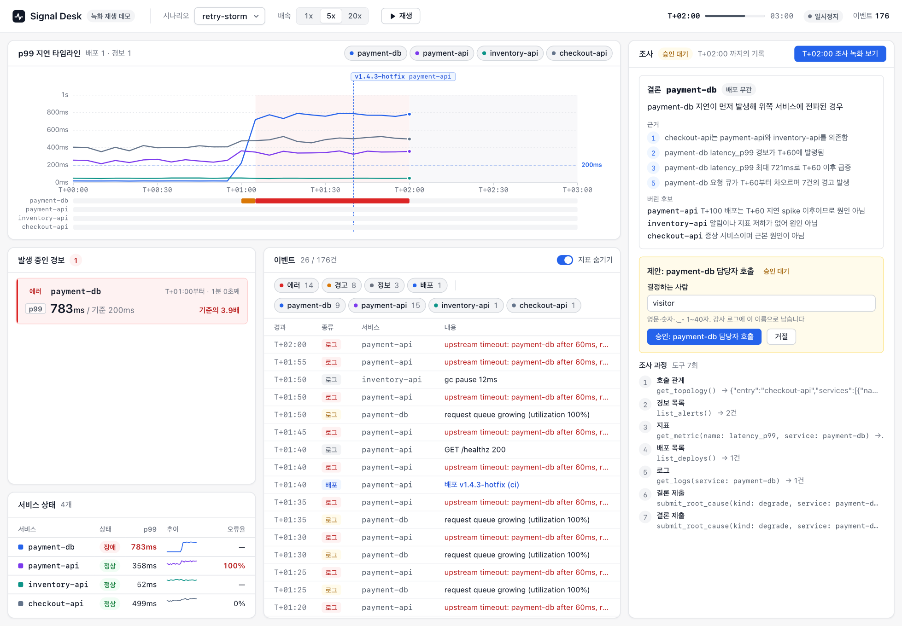

# Signal Desk

장애 원인을 찾는 AI 에이전트를 조사 시점 제한 아래에서 돌려 보고, 베이스라인과 정확도를 비교하는 작업대입니다. 실시간 장애 화면과 사람 승인 흐름을 함께 구현했습니다.

**데모:** https://bonhaenglee.github.io/signal-desk/

데모는 서버와 LLM 키 없이 돕니다. 미리 만든 이벤트를 재생하고, 조사는 실제 모델로 미리 돌린 녹화를 보여 줍니다. 승인·거절은 그 브라우저에만 반영됩니다. ([ADR-0006](docs/adr/0006-데모-배포.md))



오른쪽 조사 칸은 에이전트가 T+02:00 까지의 기록만 보고 payment-db 를 원인으로 낸 결과입니다. 근거마다 실제로 부른 도구 호출 번호가 붙고, 배제한 후보와 그 이유, 사람이 승인해야 하는 조치 제안이 함께 나옵니다.

## 무엇이 실제로 동작하나

| 항목 | 지금 | 운영에 붙이려면 |
|---|---|---|
| 이벤트 출처 | 직접 만든 시나리오 5종을 재생하는 시뮬레이터(데모는 3종), 평가용 공개 데이터셋 RCAEval RE1-OB | Prometheus·Loki·OpenTelemetry 같은 수집처를 이벤트 스키마로 바꾸는 어댑터가 필요합니다. 아직 없습니다 |
| 에이전트 | OpenAI 호환 API 로 실제 모델을 부릅니다(무료 키). 데모는 녹화를 재생합니다 | 모델과 키만 바꾸면 됩니다 |
| 조치 실행 | 승인하면 실행 기록만 남깁니다. 실제 시스템은 바꾸지 않습니다 | 조치별 실행기가 필요합니다 |
| 사용자·권한 | 인증이 없습니다. 결정한 사람 이름을 요청 그대로 믿어서 서버는 127.0.0.1 에만 엽니다 | 인증과 권한 확인이 필요합니다 |
| 조사 취소 | 없습니다. 시작한 조사는 끝날 때까지 돕니다 | 에이전트 루프에 중단 신호가 필요합니다 |

## 핵심 결과

- **직접 만든 시나리오 25건:** 에이전트 21/25·23/25(두 번 실행), 가장 높은 베이스라인 15/25. 다만 이 베이스라인은 같은 시각 경보의 출력 순서라는 단서를 썼고, 그 단서를 빼면 7/25 입니다
- **공개 데이터셋 25건:** 통계 순위(`rank_anomalies` 1위) 20/25 가 에이전트 단독 12/25, 순위를 받은 에이전트 17/25 보다 높습니다. 이 데이터에서는 통계 순위가 답을 내고, 에이전트는 그 결과를 설명하는 역할이 맞습니다
- **1만 건 이벤트 목록:** 가상화로 1건 추가가 2612ms 에서 4ms 로 줄었습니다

조건과 건별 분석은 [docs/eval.md](docs/eval.md) 에 있습니다. LLM 은 temperature 0 에서도 실행마다 결과가 달라서, 25건 기준 2~3건 차이는 개선으로 보지 않습니다.

## 다루는 문제와 한계

| 문제 | 대응 | 한계 |
|---|---|---|
| 이벤트가 초당 수십 건씩 들어오면 화면이 멈춥니다 | SSE 스트림, 목록 가상화 | 가상화 측정은 줄 높이가 고정된 목록 기준입니다 |
| 연결이 끊기면 이벤트를 놓치거나 두 번 받습니다 | `Last-Event-ID` 로 이어 받기, 중복 제거, 지수 백오프, 45초 무응답 시 재연결. 없는 조사(4xx)는 다시 요청하지 않습니다 | |
| 지난 장애로 평가할 때 에이전트가 그 뒤의 기록까지 봅니다 | 조사 시점(`atSec`)까지의 기록만 도구에 넘깁니다. 화면·API·MCP 가 같은 규칙을 씁니다 | 시뮬레이터 25건 평가는 아직 시나리오 전체 기록으로 쟀습니다 |
| 에이전트가 도구 결과에 없는 근거를 댑니다 | 결론의 근거마다 실제로 부른 도구 호출 번호를 요구하고, 없는 번호면 스키마 검증 실패로 돌려보냅니다 | 근거 문장이 그 도구 결과와 맞는지는 검사하지 않습니다. 돌려보낸 횟수는 커밋된 결과 파일에 남아 있지 않습니다 |
| 조치는 사람이 결정해야 합니다 | 승인·거절 단계, DB 트리거로 상태 전이와 수정·삭제를 막은 감사 로그. 승인 대기 제안이 있으면 다시 조사를 막습니다 | 승인 뒤 실행은 기록만 남깁니다 |
| 에이전트가 얼마나 맞히는지 모릅니다 | 정답이 붙은 시나리오와 공개 데이터셋에서 베이스라인과 같은 입력으로 비교합니다 | 시나리오는 직접 만들었습니다. 실제 운영 장애로 만든 데이터셋은 없습니다 |

## 구성

```
실시간 화면
  scenarios/*.json ─▶ 시뮬레이터 (결정적, 시드)
    ─▶ SSE 서버 ─▶ 파서 ─▶ 스키마 검증 ─▶ React 화면 (가상화 목록)

조사와 승인
  시뮬레이터 이벤트 ─▶ 조사 도구 6개
    ├─▶ 에이전트 루프 (OpenAI 호환 API) ─▶ 원인 제출
    │     ─▶ 조치 제안 ─▶ 운영자 승인/거절 ─▶ 실행 기록
    │        (단계마다 SQLite 감사 로그 + SSE 스트림)
    └─▶ MCP 서버 (stdio) ─▶ Claude Code 등에서 직접 조사
```

| 경로 | 내용 |
|---|---|
| `src/simulator/` | 서비스 의존 그래프를 큐잉 모델로 돌립니다. 원인(배포, 배포 없는 성능 저하)만 넣고 지연·에러율·경보·타임아웃 로그·재시도 폭주는 모델에서 생깁니다. `(시나리오, 시드)` 가 같으면 결과가 같습니다 |
| `scenarios/` | 정답이 붙은 시나리오 5종. 무관한 배포, 경보 없는 원인 서비스 같은 함정이 하나씩 있습니다 |
| `src/events/schema.ts` | 이벤트 스키마와 검증기. 네트워크에서 온 값은 이 검증을 통과해야 화면 상태에 들어갑니다 |
| `src/server/sse.ts` | SSE 서버. 재생 위치를 시각으로 계산해 서버 상태 없이 모든 접속자에게 같은 장면을 보냅니다 |
| `src/client/sse.ts` | SSE 파서. 청크가 메시지나 한글 바이트 중간에서 잘려 와도 복원합니다 |
| `src/client/subscribe.ts` | 재연결. 지수 백오프(1s~15s), `Last-Event-ID` 로 이어 받기, 중복 제거 |
| `src/agent/` | 조사 도구, 에이전트 루프, 베이스라인, 평가 스크립트 |
| `src/audit/store.ts` | 감사 로그와 조치 상태. 상태는 `pending→approved→executed` 또는 `pending→rejected` 로만 바뀝니다 |
| `src/server/api.ts` | 조사 시작·조회·단계 스트림·승인/거절 API |
| `src/mcp/server.ts` | 조사 도구를 MCP 로 노출합니다. 원인 제출 도구와 정답은 노출하지 않습니다 |
| `src/web/` | Vite + React 화면. 경보, 서비스별 p99, 가상화된 이벤트 목록, 조사 칸 |

## 측정

### 원인 분석 정확도

| 데이터 | 에이전트 | 하이브리드 | 베이스라인 |
|---|---|---|---|
| 직접 만든 시나리오 25건 | 21/25, 23/25 | | 최근 배포 10/25, 첫 경보 15/25 |
| RCAEval RE1-OB 반복 1 | 16/25 | | 첫 경보 10/25, z 점수 최대 21/25 |
| RCAEval RE1-OB 반복 2 | 12/25 | 17/25 | `rank_anomalies` 1위 20/25, z 점수 최대 14/25, 첫 경보 8/25 |

- 하이브리드는 `rank_anomalies` 순위를 후보로 받은 에이전트입니다. 순위 1위와 다른 답을 낸 7건 중 맞은 건 2건, 맞던 순위를 뒤집어 틀린 건 5건이었습니다
- `rank_anomalies` 1위는 장애 주입 5분 뒤 시점에서 쟀습니다. 주입 1분 뒤면 18/25, 30초 뒤면 8/25 로 떨어집니다
- z 점수 최대 베이스라인은 장애 주입 시각을 코드에서 직접 씁니다. 운영에서는 알 수 없는 정보입니다
- 모델은 `nemotron-3.5-lightning-30b-a3b`(무료)입니다. 용어 정의, 조건, 재현 명령은 [docs/eval.md](docs/eval.md) 에 있습니다

### 목록 가상화

| 1만 건 목록 | 초기 렌더 | 1건 추가 | DOM 줄 수 |
|---|---|---|---|
| 가상화 없음 | 2764ms | 2612ms | 10,000 |
| TanStack Virtual | 3ms | 4ms | 34 |

측정 방법과 한계는 [ADR-0002](docs/adr/0002-목록-가상화.md) 에 있고, `/?bench&n=10000` 에서 직접 재 볼 수 있습니다. 기계 부하에 따라 수치가 달라집니다.

## 실행

Node 24 이상이 필요합니다. 서버 코드는 빌드 없이 Node 의 type stripping 으로 실행됩니다.

```sh
npm install
cp .env.example .env.local   # 조사 API 를 쓸 때만. OpenAI 호환 엔드포인트와 키
npm run dev:server   # SSE 서버 http://localhost:4100 (키가 있으면 조사 API 도 켜짐)
npm run dev:web      # 화면 http://localhost:5180
```

```sh
# 조사 한 건 시작 → 단계 스트림 → 승인
curl -X POST localhost:4100/investigations -d '{"scenario":"silent-db","seed":1,"atSec":120}'   # atSec: 이 초까지의 기록만 본다
curl -N localhost:4100/investigations/<id>/stream
curl -X POST localhost:4100/proposals/<proposalId>/decision -d '{"operator":"kim","decision":"approved"}'
```

Claude Code 에서 저장소를 열면 `.mcp.json` 의 `signal-desk` MCP 서버가 붙습니다. `load_incident` 로 시나리오를 고른 뒤 같은 조사 도구를 씁니다. `atSec` 을 주면 그 초까지의 기록만 보고, 빼면 끝난 장애로 보고 전체 기록을 줍니다.

```sh
npm test             # 테스트 (node:test)
npm run typecheck    # 타입 검사
npm run simulate -- scenarios/retry-storm.json 7   # 이벤트를 NDJSON 으로 출력
npm run build:demo   # 녹화 재생 데모 빌드 (dist/, GitHub Pages 경로 /signal-desk/)
```

## 설계 결정

- [ADR-0000 기술 선택 절차](docs/adr/0000-스택-결정-절차.md)
- [ADR-0001 화면 프레임워크](docs/adr/0001-화면-프레임워크.md) — Vite + React. Next.js 를 버린 이유
- [ADR-0002 목록 가상화](docs/adr/0002-목록-가상화.md) — 실측 비교와 남은 문제
- [ADR-0003 접근성 컴포넌트와 스타일](docs/adr/0003-UI-컴포넌트와-스타일.md) — Radix + CSS Modules. React Aria·Base UI 와 비교
- [ADR-0004 MCP 서버](docs/adr/0004-MCP-서버.md) — 공식 SDK, 저수준 `Server` 를 쓴 이유
- [ADR-0005 감사 로그 저장소](docs/adr/0005-감사-로그-저장소.md) — SQLite, 동시 승인 처리, PostgreSQL 이 이기는 조건
- [ADR-0006 데모 배포](docs/adr/0006-데모-배포.md) — 서버 없는 녹화 재생, GitHub Pages

## 변경 이력

- **v0.1** SSE 스트림, 목록 가상화
- **v0.2** 재연결·중복 제거, 조사 에이전트, 시나리오 5종으로 베이스라인 비교, MCP 서버, CI
- **v0.3** 승인 단계와 감사 로그 (서버·API)
- **v0.4** 조사 화면, 공개 데이터셋 RCAEval RE1-OB 평가, 녹화 재생 데모

## 다음에 할 것

- 같은 시각 이벤트의 출력 순서를 섞고 시뮬레이터 평가를 조사 시점 제한으로 다시 잽니다
- 근거 문장이 가리킨 도구 결과와 맞는지 검사합니다
- 조사 취소를 넣습니다
- 수집처 어댑터를 하나(OpenTelemetry 또는 Prometheus) 붙입니다

## 라이선스

MIT
