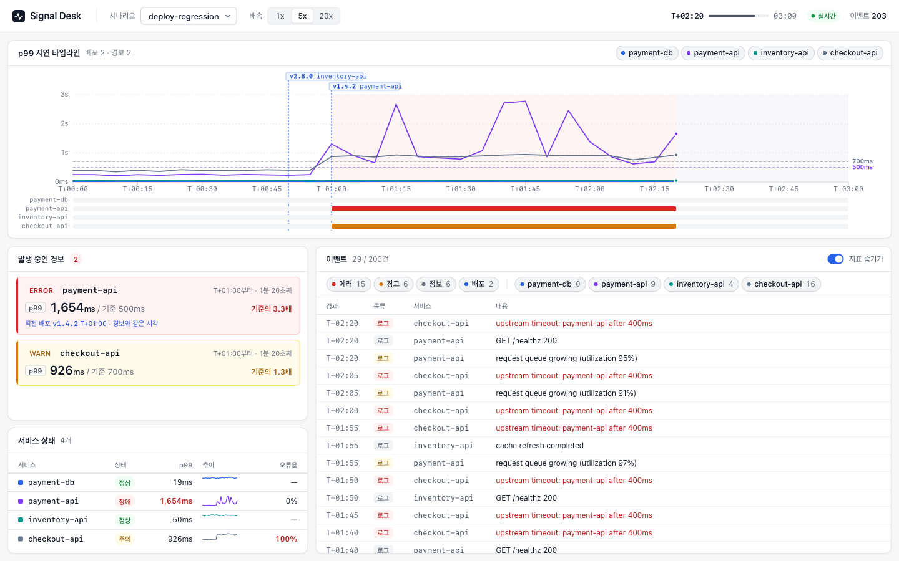

# Signal Desk

실시간 이벤트로 장애를 보여 주고, AI 에이전트가 원인을 조사·제안하며, 운영자가 승인한 조치만 실행하는 장애 대응 워크벤치.

> **진행 중 (v0.3).** 시뮬레이터, SSE 실시간 전송과 재연결, 조사 에이전트와 정답률 평가, 조치 승인 게이트와 감사 로그, MCP 서버까지 동작합니다. 조사 과정 화면과 외부 데이터셋 평가가 남았습니다.



## 왜 만드나

로그·지표를 AI 에 넘겨 원인을 묻는 것은 이제 어렵지 않습니다. 운영에 붙이면 다른 문제가 남습니다.

| 문제 | 이 프로젝트의 대응 | 상태 |
|---|---|---|
| 경보와 로그가 초당 수십 건씩 쏟아지면 화면이 멈춘다 | SSE 스트림 + 목록 가상화 | ✅ v0.1 |
| 연결이 끊기면 이벤트를 놓치거나 중복으로 받는다 | `Last-Event-ID` 이어받기, 지수 백오프, 하트비트 감시 | ✅ v0.2 |
| 에이전트가 근거 없이 원인을 단정한다 | 도구 호출 결과를 근거로 제출, 제출 인자 검증 | ✅ v0.2 |
| 에이전트가 제안한 조치가 확인 없이 실행된다 | 승인 게이트 + 수정·삭제가 막힌 감사 로그 | ✅ v0.3 |
| 에이전트가 얼마나 정확한지 잴 방법이 없다 | 정답이 있는 시나리오로 단순 규칙과 비교 | ✅ v0.2 / 공개 데이터셋은 v0.4 |

## 구성

```
scenarios/*.json ─▶ 시뮬레이터 ─▶ SSE 서버 ─(text/event-stream)─▶ 파서 ─▶ 스키마 검증 ─▶ React 화면
                  (결정적, 시드)   (Node http)                      (fetch 스트림)            (가상화 목록)
                        │
                        ▼
                  조사 도구 6개 ─┬─▶ 에이전트 루프 ─▶ 원인 제출 ─▶ 조치 제안 ─▶ 운영자 승인/거절 ─▶ 실행 기록
                                 │   (OpenAI 호환 API)                     (SQLite 감사 로그, 단계마다 SSE)
                                 └─▶ MCP 서버 (stdio) ─▶ Claude Code 등에서 같은 도구로 직접 조사
```

| 경로 | 내용 |
|---|---|
| `src/simulator/` | 서비스 의존 그래프를 대기열 모델로 돌린다. 원인(배포, 조용한 성능 저하)만 주입하고 지연·에러율·경보·타임아웃 로그·재시도 폭주는 모델에서 생긴다. `(시나리오, 시드)` 가 같으면 결과가 같다 |
| `scenarios/` | 정답(원인)이 붙은 시나리오 5종. 각각 함정이 있다: 무관한 배포, 배포 없는 DB 저하, 회복 뒤에도 이어지는 재시도 폭주, 경보 없는 원인 서비스 2종 |
| `src/events/schema.ts` | 이벤트 스키마와 검증기. 네트워크에서 온 값은 이 검증을 통과해야 화면 상태에 들어간다 |
| `src/server/sse.ts` | SSE 서버. 재생 위치를 시각으로 계산해 서버 상태 없이 모든 접속자에게 같은 장면을 보낸다. `Last-Event-ID` 이어받기, 하트비트, 시나리오 목록 검사 |
| `src/client/sse.ts` | SSE 파서. 네트워크 조각이 메시지·한글 바이트 경계에서 잘려 와도 복원한다 |
| `src/client/subscribe.ts` | 재연결. 지수 백오프(1s~15s), `Last-Event-ID` 로 이어 받기, 중복 거르기, 하트비트 45s 무응답 시 재연결 |
| `src/agent/` | 조사 도구, 에이전트 루프, 기준선 2개, 평가 스크립트 |
| `src/audit/store.ts` | 감사 로그와 조치 상태. 상태는 `pending→approved→executed` 또는 `pending→rejected` 로만 바뀐다 |
| `src/server/api.ts` | 조사 시작·조회·단계 스트림·승인/거절 API |
| `src/mcp/server.ts` | 조사 도구를 MCP 로 노출. 원인 제출 도구와 정답은 노출하지 않는다 |
| `src/web/` | Vite + React 화면. 경보, 서비스별 p99, 가상화된 이벤트 목록 |

## 측정

### 원인 맞히기

정답이 있는 시나리오 5개 × 시드 5개 = 25건. 에이전트와 단순 규칙 두 개를 같은 사건으로 채점했다. 정답은 원인 서비스와 종류(배포 탓/배포 없는 저하)가 모두 맞을 때다.

| 시나리오 | 함정 | 에이전트 | 최근 배포 탓 | 첫 경보 서비스 탓 |
|---|---|---|---|---|
| deploy-regression | 원인 10초 전 무관한 배포 | 5/5 | 5/5 | 5/5 |
| db-degradation | 직전 배포가 원인 아님 | 4/5 | 0/5 | 5/5 |
| retry-storm | 경보 뒤 배포가 원인 아님 | 5/5 | 0/5 | 5/5 |
| silent-db | 원인 DB 에 경보 없음 + 직전 배포 | 2/5 | 0/5 | 0/5 |
| hidden-deploy | 원인 서비스에 경보 없음 | 5/5 | 5/5 | 0/5 |
| **전체** | | **21/25** | 10/25 | 15/25 |

- 조건: 모델 `nemotron-3.5-lightning-30b-a3b`(무료), temperature 0, 실행 1회. 조사 1건 평균 도구 호출 7.3회, 27초. 25건 결과는 [`eval/nemotron-3.5-lightning-30b-a3b.json`](eval/nemotron-3.5-lightning-30b-a3b.json)
- 처음 만든 시나리오 3개만으로는 "첫 경보 서비스 탓" 규칙도 15/15 를 맞혀 에이전트와 구분되지 않았다. 원인 서비스에 경보가 없는 시나리오 2개를 추가해 규칙과 갈리게 했다
- **약점: 원인이 깊으면 중간에서 멈춘다.** 틀린 4건 중 3건이 원인 DB 바로 위 서비스(`payment-api`)를 제출했다. 같은 모델로 silent-db 를 조사 API 로 돌린 기록에서는 payment-api 로그가 `upstream timeout: payment-db` 를 가리키는데도 payment-db 를 조회하지 않고 제출했다
- **한계:** 에이전트 지시문에 "증상 이후 배포는 원인이 아니다" 같은 문장이 있다. 함정을 아는 사람이 썼으므로 이 시나리오에 유리할 수 있다. 공개 데이터셋 평가(v0.4)로 확인해야 한다. 시드 5개·실행 1회라 1~2건 차이는 우연일 수 있다
- 재현: `npm run eval -- 5 nemotron-3.5-lightning-30b-a3b 5000` (`.env.example` 참고). 끝난 건은 다시 돌리지 않는다

### 목록 가상화

| 1만 건 목록 | 처음 그리기 | 1건 추가 | DOM 줄 수 |
|---|---|---|---|
| 가상화 없음 | 2764ms | 2612ms | 10,000 |
| TanStack Virtual | 3ms | 4ms | 34 |

측정 방법과 한계는 [ADR-0002](docs/adr/0002-목록-가상화.md). `/?bench&n=10000` 에서 직접 재 볼 수 있습니다.

## 설계 결정

모든 기술 선택은 후보 2개 이상, 비교 근거, 버린 대안의 가장 강한 장점, 되돌리는 비용을 적은 ADR 로 남깁니다.

- [ADR-0000 기술 선택 절차](docs/adr/0000-스택-결정-절차.md)
- [ADR-0001 화면 프레임워크](docs/adr/0001-화면-프레임워크.md) — Vite + React. Next.js 를 버린 이유
- [ADR-0002 목록 가상화](docs/adr/0002-목록-가상화.md) — 실측 비교와 남은 문제
- [ADR-0004 MCP 서버](docs/adr/0004-MCP-서버.md) — 공식 SDK, 저수준 `Server` 를 쓴 이유
- [ADR-0005 감사 로그 저장소](docs/adr/0005-감사-로그-저장소.md) — SQLite, 동시 승인 처리, PostgreSQL 이 이기는 조건

## 실행

Node 24 이상이 필요합니다. 서버 코드는 빌드 없이 Node 의 타입 제거 실행으로 돕니다.

```sh
npm install
cp .env.example .env.local   # 조사 API 를 쓸 때만. OpenAI 호환 엔드포인트와 키
npm run dev:server   # SSE 서버 http://localhost:4100 (키가 있으면 조사 API 도 켜짐)
npm run dev:web      # 화면 http://localhost:5180
```

```sh
# 조사 한 건 시작 → 단계 스트림 → 승인
curl -X POST localhost:4100/investigations -d '{"scenario":"silent-db","seed":1}'
curl -N localhost:4100/investigations/<id>/stream
curl -X POST localhost:4100/proposals/<proposalId>/decision -d '{"operator":"kim","decision":"approved"}'
```

Claude Code 에서 저장소를 열면 `.mcp.json` 의 `signal-desk` MCP 서버가 붙는다. `load_incident` 로 시나리오를 고른 뒤 같은 조사 도구를 쓸 수 있다.

```sh
npm test             # 테스트 (node:test)
npm run typecheck    # 타입 검사
npm run simulate -- scenarios/retry-storm.json 7   # 이벤트를 NDJSON 으로 출력
```

## 로드맵

- ✅ **v0.2** 재연결·중복 제거, 조사 에이전트, 시나리오 5종 정답률을 기준선 2개와 비교, MCP 서버, CI
- ✅ **v0.3** 승인 게이트와 감사 로그 (서버·API)
- **다음** 조사 과정과 승인 버튼을 화면에 표시
- **v0.4** 공개 데이터셋 [RCAEval](https://doi.org/10.5281/zenodo.14590730) (CC BY 4.0) 일부로 외부 기준 평가, 녹화 재생 데모 배포

## 라이선스

MIT
